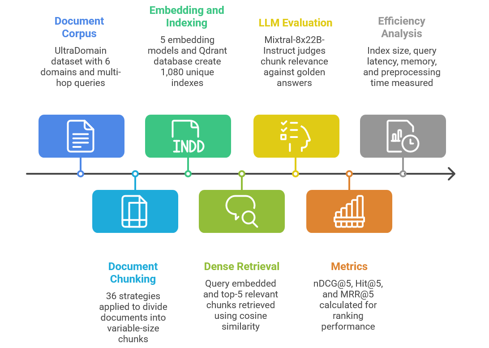

# ChunkBench: Document Chunking Strategy Benchmark

ChunkBench is a large-scale, cross-domain benchmark designed to evaluate document chunking strategies for dense retrieval. It provides a comprehensive suite of chunking methods, from simple fixed-length strategies to advanced semantic and LLM-based approaches.

This is the reference implementation for **"A Systematic Investigation of Document Chunking Strategies and Embedding Sensitivity"** (Shaukat, Adnan & Kuhn), [arXiv:2603.06976](https://arxiv.org/html/2603.06976).

## Methodology



Every configuration goes through the same retrieval-only pipeline, so the chunking strategy and the embedding model are the only things that change:

1. **Chunk.** Documents are split by each of the 36 strategies. The strategies differ in how they choose chunk boundaries: fixed-size, structural, recursive, semantic, late chunking, adaptive, LLM-driven or hybrid.
2. **Embed and index.** The chunks are embedded with each of five dense encoders and stored in a separate Qdrant collection per configuration. Across 36 strategies, 5 models and 6 UltraDomain domains, this gives 1,080 indexes.
3. **Retrieve.** Each query is embedded with the same encoder, and the top-5 chunks are retrieved by cosine similarity.
4. **Judge.** An LLM grades each retrieved chunk against the golden reference answer on a three-point scale (0 = not relevant, 1 = partially relevant, 2 = fully relevant). The judge never sees the query, which prevents lexical bias. The paper reports nDCG@5, Hit@5 and MRR@5 computed from these grades.
5. **Measure efficiency.** Index size, query latency, memory use and preprocessing time are recorded for every configuration.

Reference answers are used only in the judging stage. Chunking, indexing and retrieval never see them. There is no answer-generation step: the benchmark evaluates retrieval only.

Run every command below from the repository root (the folder that contains `chunking_strategies/`).

---

## Step 1: Requirements

- Python 3.10, and [Conda](https://docs.conda.io/en/latest/miniconda.html)
- [Docker](https://docs.docker.com/get-docker/) to run the Qdrant vector database
- [Ollama](https://ollama.com/download) to run the LLM judge
- An NVIDIA GPU is recommended.
## Step 2: Create the environment

```bash
conda create -n chunkbench python=3.10 -y
```

```bash
conda activate chunkbench
```

```bash
pip install -r chunking_strategies/requirements.txt
```


## Step 3: Download and prepare a dataset

You can use either of two corpora. Each one gives you, per domain, a **documents file** (to chunk) and a **queries file** (to retrieve with).

**UltraDomain**
```bash
python chunking_strategies/data/dataDownload.py
```

```bash
python chunking_strategies/data/cleaning.py
```

| Output | Path |
|---|---|
| Documents | `chunking_strategies/data/domain_context/<domain>_unique_contexts.json` |
| Queries | `chunking_strategies/data/global_data/<domain>/queries_and_answers.jsonl` |

**BRIGHT**
```bash
python chunking_strategies/data/brightDownload.py
```

```bash
python chunking_strategies/data/cleaning.py -i chunking_strategies/data/bright_data -o chunking_strategies/data/bright_context
```

| Output | Path |
|---|---|
| Documents | `chunking_strategies/data/bright_context/<domain>_unique_contexts.json` |
| Queries | `chunking_strategies/data/bright_data/<domain>/queries_and_answers.jsonl` |


## Step 4: Configure the experiment

All settings are in **`chunking_strategies/chunkbench_config.py`**. The "Experiment setup" section of that file contains placeholders written as `<...>`. Fill them in before running anything. A script stops with a message naming any placeholder it needs that is still unset.

| Setting | Environment variable | What to put |
|---|---|---|
| `DOCUMENTS_FILE` | `CHUNKBENCH_DOCUMENTS` | Documents file from Step 3, for **one** domain |
| `DOMAINS` | `CHUNKBENCH_DOMAINS` | The name of that domain, e.g. `biology` |
| `QUERY_FILE_TEMPLATE` | `CHUNKBENCH_QUERY_TEMPLATE` | Queries path from Step 3, with `{domain}` in place of the domain name |
| `EMBEDDING_MODEL` | `CHUNKBENCH_EMBEDDING_MODEL` | Hugging Face id of a sentence-transformers encoder |
| `LLM_CHUNKER_MODEL` | `CHUNKBENCH_LLM_CHUNKER_MODEL` | Hugging Face id of an instruct model for the two LLM chunkers |
| `OLLAMA_MODEL` | `CHUNKBENCH_OLLAMA_MODEL` | Ollama tag of the judge model |

You can either edit the file directly or export the environment variables, which take precedence over the file. Exporting is convenient when you sweep several domains or models. For example, for UltraDomain biology:

```bash
export CHUNKBENCH_DOCUMENTS=chunking_strategies/data/domain_context/biology_unique_contexts.json
export CHUNKBENCH_DOMAINS=biology
export CHUNKBENCH_QUERY_TEMPLATE='chunking_strategies/data/global_data/{domain}/queries_and_answers.jsonl'
export CHUNKBENCH_EMBEDDING_MODEL=BAAI/bge-m3
export CHUNKBENCH_OLLAMA_MODEL=mixtral:8x22b
```

These are the embedding models evaluated in the paper:

| Model | Dimensions |
|---|---|
| `BAAI/bge-m3` | 1024 |
| `sentence-transformers/all-MiniLM-L6-v2` | 384 |
| `minishlab/potion-base-8M` | 256 |
| `minishlab/potion-base-4M` | 128 |
| `minishlab/potion-base-2M` | 64 |


The same file holds optional performance settings, each documented next to its value. The ones you are most likely to change:

- `CHUNKBENCH_WORKERS`: the number of strategies chunked in parallel (default `1`). Keep it at `1` if you need accurate per-strategy RAM/GPU figures.
- `CHUNKBENCH_EMBED_BATCH_SIZE`: the embedding batch size. It is halved automatically if the GPU runs out of memory.
- `CHUNKBENCH_TOP_K`: the number of chunks retrieved per query (default `5`).
- `CHUNKBENCH_QDRANT_HOST` and `CHUNKBENCH_QDRANT_PORT`: where Qdrant is running.
- `CHUNKBENCH_RESULTS_DIR`: where the outputs are written.

## Step 5: Start Qdrant and Ollama

```bash
docker run -d -p 6333:6333 -p 6334:6334 qdrant/qdrant
```

```bash
ollama serve
```

In a second terminal, pull the judge model you configured:

```bash
ollama pull mixtral:8x22b
```

Use a **dedicated** Qdrant instance. Retrieval queries every collection on the server, and the cleanup script deletes every collection.

## Step 6: Run the benchmark

```bash
python chunking_strategies/scripts/run_all_strategies.py
```

```bash
python chunking_strategies/scripts/run_indexing.py
```

```bash
python chunking_strategies/scripts/run_retrieval.py
```

```bash
python chunking_strategies/scripts/eval/jude.py
```

`run_all_strategies.py` runs each strategy in its own subprocess, so if one chunker crashes, the others still finish. To run a single strategy instead:

```bash
python chunking_strategies/scripts/run_single_strategy.py fixed_token_chunking
```

To turn strategies on or off, or to change their parameters, edit `chunking_strategies/chunking/chunker_config.json`. Each strategy there has an `enabled` flag and a `params` block.

## Step 7: Read the results

All outputs are written under `chunking_strategies/results/`, separated by stage and domain:

| Path | Contents |
|---|---|
| `chunking/<domain>/chunks/<strategy>.jsonl` | The chunks (`text`, `chunk_id`, `doc_id`, `metadata`) |
| `chunking/<domain>/stats/<strategy>_metrics.json` | Chunk statistics, run time, peak RAM/GPU |
| `retrieval/<domain>/results/<strategy>_dense_retrieval.json` | Top-K chunks per query, with scores |
| `retrieval/<domain>/stats/<strategy>_retrieval_metrics.json` | Search timing and score distribution |
| `eval/<domain>/<domain>_<strategy>_llm_judge.csv` | Relevance grade (0/1/2) and the judge's reasoning, per chunk |

## Step 8: Run the next domain or model

When you change the domain or the embedding model, **reset before re-running**. Old chunk files and Qdrant collections are not always overwritten, and leftovers get indexed and judged as if they came from the current run.

```bash
rm -rf chunking_strategies/results
```

```bash
python chunking_strategies/scripts/cleanVD_Collections.py
```

To list the collections without deleting anything, prefix the second command with `DRY_RUN=1`. Then update the settings from Step 4 and repeat Step 6.

---

## Resources

**Datasets**
- UltraDomain: <https://huggingface.co/datasets/TommyChien/UltraDomain>
- BRIGHT: <https://huggingface.co/datasets/xlangai/BRIGHT>

**Embedding models** (Hugging Face)
- all-MiniLM-L6-v2: <https://huggingface.co/sentence-transformers/all-MiniLM-L6-v2>
- bge-m3: <https://huggingface.co/BAAI/bge-m3>
- potion-base-2M: <https://huggingface.co/minishlab/potion-base-2M>
- potion-base-4M: <https://huggingface.co/minishlab/potion-base-4M>
- potion-base-8M: <https://huggingface.co/minishlab/potion-base-8M>

**LLM judges** (Ollama).
- mixtral:8x22b: <https://ollama.com/library/mixtral:8x22b>
- llama3:70b-instruct: <https://ollama.com/library/llama3:70b-instruct>
- qwen2.5:72b: <https://ollama.com/library/qwen2.5:72b>

**Generated data.** The chunk files, retrieval rankings, judge labels and derived metrics from the paper are available at <https://doi.org/10.17632/c8w2gcm83y.1>.


## Citation

```bibtex
@article{shaukat2026chunking,
  title   = {A Systematic Investigation of Document Chunking Strategies and Embedding Sensitivity},
  author  = {Shaukat, Muhammad Arslan and Adnan, Muntasir and Kuhn, Carlos C. N.},
  journal = {arXiv preprint arXiv:2603.06976},
  year    = {2026}
}
```
